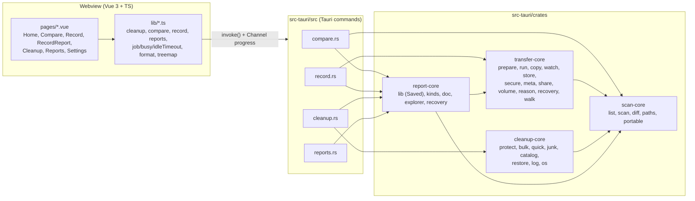

# Architecture (as found, v1.1.1 @ 302f751)

## 1. Shape

A single-process Windows desktop app: a Tauri 2 shell hosting a Vue 3 webview. All file-system work runs in Rust and is split into four library crates. There is no network code in the app. Distribution is GitHub Releases plus a PowerShell "USB kit".



Crate dependencies (from `Cargo.toml`s): `scan-core` ← `transfer-core`, `cleanup-core`; `report-core` → `scan-core`, `transfer-core`. **cleanup-core does not depend on report-core or transfer-core.** That matters for DSA-014 (data roots must be passed in) and for where the shared helpers go (see section 7).

## 2. Module map

| Module                         | Responsibility                                                                                                                           | Size hot spots                            |
| ------------------------------ | ---------------------------------------------------------------------------------------------------------------------------------------- | ----------------------------------------- |
| `src-tauri/src/lib.rs`         | Builder: plugins `dialog`, `opener`; managed state `CleanupState`, `CompareState`, `RecordState`; command registration (`lib.rs:63-103`) | –                                         |
| `src-tauri/src/compare.rs`     | `compare_run` (scan both sides via `spawn_blocking`, diff, save report), children, reveal, missing list, cancel                          | sync `compare_missing` (DSA-031)          |
| `src-tauri/src/record.rs`      | Prepare, run, watch, retry, recovery, share sign-in, reveal; one job at a time (`RecordState`)                                           | process-wide privileges (DSA-015)         |
| `src-tauri/src/cleanup.rs`     | Disk scan, children, junk, single and bulk delete, restore, quick clean, drives, elevate/restart                                         | 560 lines; two delete paths (DSA-002)     |
| `src-tauri/src/reports.rs`     | List, delete, prune, export, open in browser                                                                                             | export to any path (DSA-011)              |
| `scan-core::list`              | `FindFirstFileExW`/`GetFileInformationByHandleEx` directory listing, reparse/cloud classification, `\\?\` long paths                     | lossy names (DSA-022), tag test (DSA-017) |
| `scan-core::scan`              | Parallel (rayon) size tree, progress counters, cancel                                                                                    | recursion (DSA-045)                       |
| `scan-core::diff`              | Two-tree size compare, missing list                                                                                                      | links in missing (DSA-023)                |
| `transfer-core::prepare`       | Pre-flight: manifest, blocked items (cloud, names, collisions)                                                                           | memory (DSA-033)                          |
| `transfer-core::run/copy`      | Copy with `.dspart` + rename, verify (size/time/hash), retry with backoff, conflict policy                                               | DSA-006, DSA-021                          |
| `transfer-core::watch`         | Watch another tool copy (notify), infer verdicts                                                                                         | DSA-007, DSA-034                          |
| `transfer-core::store`         | Run folder: `run.json` (atomic), `manifest.jsonl`, `results.jsonl` (append + flush), audit log                                           | DSA-008, DSA-009                          |
| `transfer-core::secure/meta`   | ACL/owner/ADS/attrs copy, backup/restore privileges                                                                                      | DSA-015                                   |
| `cleanup-core::protect`        | Never-delete list (string-prefix)                                                                                                        | DSA-001, DSA-014                          |
| `cleanup-core::bulk`           | Preview, confirm token, big-run brake, per-item delete, reparse check                                                                    | DSA-013, DSA-028                          |
| `cleanup-core::quick`          | Temp, Windows Temp, Update cache, Recycle Bin, old installers                                                                            | DSA-003, DSA-016                          |
| `cleanup-core::junk/catalog`   | Junk classification over the scan tree                                                                                                   | 1,380 lines (DSA-053)                     |
| `cleanup-core::restore/log/os` | `deletions.jsonl`, `$I`/`$R` parsing, restore last run                                                                                   | DSA-012, DSA-048                          |
| `report-core`                  | `Saved` reports JSON; HTML (escaped, hash-CSP) and CSV (formula-defused) export; disk explorer page                                      | DSA-024, DSA-029, DSA-030                 |

## 3. Data flow

**Compare.**

1. The user picks Left and Right (`PathField`).
2. `compare_run` → `scan-core::scan` twice (`spawn_blocking`, progress through `Channel` about every 100 ms).
3. `diff` builds the tree.
4. The result is kept in `CompareState`.
5. The UI pulls one folder level at a time (`compare_children`).
6. `save_report` writes `Reports\<id>.json`.

**Record.**

1. `record_prepare` builds `Records\<run>\manifest.jsonl` and `run.json` (state `Prepared`).
2. `record_run` → `run_copy`: state `Running`, then each file is copied to `.dspart`, renamed, verified, and appended to `results.jsonl`.
3. `finish` sets the state to `Done` or `Cancelled`.
4. Retry and recovery reread `results.jsonl`.
5. Watch mode uses `notify` events instead of copying.

**Disk Cleanup.**

1. `cleanup_scan` builds the tree and saves a `DiskUsage` report with explorer data.
2. Delete: bulk preview → token → `bulk::run` → `recycle` (`cleanup-core::os`; Windows API used not re-checked in this review) or `delete_permanently` → `log::append` → report updated with `removed`.
3. Quick cleanups go through `quick::clean`, which deletes permanently.
4. Restore reads the log and the Recycle Bin `$I` files.

**Reports.** `reports_list` fully loads every `Saved` (DSA-030) plus record runs. Export writes HTML or CSV to a path the webview supplies. "Open" writes `%TEMP%\Deep Server Analyzer reports\<id>.html` and opens it in the browser.

## 4. Runtime artefacts

| Path                                                                              | Written by        | Content                                           | Notes                                                                     |
| --------------------------------------------------------------------------------- | ----------------- | ------------------------------------------------- | ------------------------------------------------------------------------- |
| `%LOCALAPPDATA%\Deep Server Analyzer\Reports\*.json`                              | report-core       | Paths, sizes, machine, user name, company "brand" | Override `DEEP_SERVER_ANALYZER_REPORTS_DIR`. Rewritten in place (DSA-029) |
| `…\Records\<run>\{run.json,manifest.jsonl,results.jsonl,audit…}`                  | transfer-core     | Per-file paths and outcomes                       | Override `_RECORDS_DIR`                                                   |
| `…\Logs\deletions.jsonl` (+ `.1`)                                                 | cleanup-core::log | Every delete: time, user, elevated, path, size    | Override `_LOGS_DIR`. One rotation (DSA-048)                              |
| `%TEMP%\Deep Server Analyzer reports\*.html`                                      | reports.rs        | Rendered report                                   | Never cleaned                                                             |
| Portable folder (`scan_core::portable_data_dir`)                                  | –                 | Same layout when portable                         | –                                                                         |
| `C:\ProgramData\DSA\{trust.log,trust-expiry.json,DsaTrust.psm1,Remove-Trust.ps1}` | USB kit           | Trust state; scripts run by SYSTEM                | DSA-005                                                                   |
| Scheduled task `DSA-TrustExpiry`                                                  | USB kit           | SYSTEM, at expiry + at startup                    | –                                                                         |

None of these hold secrets. `transfer-core::share` takes a share password for sign-in and zeroes it after use; the sweep found it is not persisted (INFERRED, not executed). The files do hold user names, machine names and full paths, which is client data: they are per-user under `%LOCALAPPDATA%`, with default ACLs.

## 5. Trust boundaries

| #   | Boundary                                       | Untrusted side                                                       | Controls today                                                                                                        | Gaps                                                                                                                      |
| --- | ---------------------------------------------- | -------------------------------------------------------------------- | --------------------------------------------------------------------------------------------------------------------- | ------------------------------------------------------------------------------------------------------------------------- |
| T1  | Webview → Rust commands                        | Anything that runs JS in the webview                                 | Commands take ids rather than paths (mostly); capabilities limited to window, dialog, opener                          | `csp: null` (DSA-010); `report_export` path (DSA-011); `record_reveal` path (DSA-037); `opener:allow-open-path` (DSA-038) |
| T2  | User-chosen scan or delete roots → file system | Odd path spellings, reparse points                                   | String never-delete list; item-level reparse check; Recycle Bin by default; admin needed for permanent/big runs       | DSA-001, DSA-013, DSA-016, DSA-017                                                                                        |
| T3  | On-disk app data → app logic                   | Files in `%LOCALAPPDATA%` (user-writable) when the app runs elevated | Report-id and run-id validation; bounded `$I` parse                                                                   | Restore targets (DSA-012); `..` in run files (DSA-039)                                                                    |
| T4  | GitHub Release → admin's machine               | Anyone who can alter the zip in transit or at rest                   | Authenticode signature checked against the in-kit certificate; SHA256SUMS in the kit; a human compares the thumbprint | Self-referential anchor and no certificate constraints (DSA-004); 12-char display (DSA-019); no provenance (DSA-067)      |
| T5  | Kit → SYSTEM scheduled task                    | Standard users on the same machine                                   | Scripts copied by an admin                                                                                            | ProgramData ACL (DSA-005)                                                                                                 |
| T6  | Repo → release build                           | Contributors with write access; third-party actions                  | All actions pinned by SHA; `contents: read` by default; ephemeral key deleted                                         | No environment protection on tag releases (DSA-064); floating toolchains (DSA-063); no audit or secret scan (DSA-020)     |

## 6. Release and install flow

```mermaid
sequenceDiagram
  autonumber
  actor Owner
  participant GH as GitHub (Demonad112/special-memory-analyzer)
  participant WinRunner as release.yml: installer (windows-latest)
  participant Rel as release.yml: release (ubuntu)
  actor Admin as Server admin
  participant Kit as USB kit (Install-DSA.ps1)
  participant Win as Target Windows

  Owner->>GH: scripts/Set-ReleaseTag.ps1 (checks CI green on origin/main, pushes vX.Y.Z)
  GH->>WinRunner: on push tag v*
  WinRunner->>WinRunner: check tag == package.json == tauri.conf == Cargo.toml
  WinRunner->>WinRunner: New-SelfSignedCertificate (CodeSigning, RSA-3072, 180 d), trust it on the runner
  WinRunner->>WinRunner: tauri build (NSIS), sign with thumbprint + RFC3161 timestamp
  WinRunner->>WinRunner: verify Authenticode (Valid, thumbprint, timestamp)
  WinRunner->>WinRunner: build kit: setup.exe + .cer + scripts + thumbprint.txt + SHA256SUMS.txt → zip
  WinRunner->>WinRunner: always(): delete the cert and private key
  WinRunner-->>Rel: artifacts
  Rel->>GH: gh release create (installer .exe, kit zip, .cer, SHA256SUMS) + thumbprint in notes
  Admin->>GH: download zip (browser or Get-Release.ps1)
  Note over Admin,GH: Only out-of-band anchor: the thumbprint in the release notes (manual compare)
  Admin->>Kit: Install-DSA.cmd (self-elevates)
  Kit->>Kit: thumbprint.txt == cert? SHA256SUMS ok? (all from the same zip: DSA-004)
  Kit->>Win: add cert to LocalMachine\Root + TrustedPublisher (no EKU/CA check: DSA-004)
  Kit->>Win: copy scripts to ProgramData\DSA, register SYSTEM task (DSA-005)
  Kit->>Kit: Authenticode(setup.exe) == Valid && signer == cert
  Kit->>Win: setup.exe /S (per-machine NSIS; WebView2 bootstrapper may download)
  Win-->>Win: task at expiry or startup removes trust
```

There is **no auto-update**. Users update by downloading a newer release, and rollback means installing an older release's installer. The NSIS `webviewInstallMode: downloadBootstrapper` (`tauri.conf.json:42-45`) fetches the WebView2 runtime from Microsoft at install time if it is missing. That is Microsoft-signed and HTTPS, so it was not flagged.

## 7. Proposed target structure (only where it pays off)

There is no big-bang refactor. The crate split is sound. Target these changes:

1. **One safe-path module.** Create `cleanup_core::pathsafe` with `canonical_root`, `normalize`, `is_reparse_point`, `has_reparse_ancestor` and `is_link_tag`. It is used by protect, bulk, quick and restore, and scan-core uses the tag function. This removes the three divergent link checks behind DSA-016 and DSA-017 (DSA-054). `canonical_root` lives in `scan-core::paths` (lowest crate), and `pathsafe` re-exports it.
2. **One delete pipeline.** Every delete (single, bulk, and quick as a summary) runs through `bulk::run` and is followed by a shared `log_entries` and `record_removed` (DSA-002, DSA-028, DSA-054).
3. **One atomic-write helper.** Add `transfer_core::fsutil::write_atomic`, used by report-core and the store (DSA-029, DSA-046).
4. **Frontend job objects.** `compareJob` joins `cleanupJob` and `recordJob` in `src/lib/` (DSA-027), and pages become views over them.
5. **File splits.** Split `junk.rs`, `kinds.rs`, the HTML/JS/CSS assets in `doc.rs`/`explorer.rs`, `CleanupPage.vue` and `ComparePage.vue` (DSA-053). Do this after the tests exist.

## 8. External dependencies

| Ecosystem     | Direct                                                                                                              | Pinning                              | Notes                                                                  |
| ------------- | ------------------------------------------------------------------------------------------------------------------- | ------------------------------------ | ---------------------------------------------------------------------- |
| npm (runtime) | `vue` 3.5.43, `vue-router` 5.3.1, `@tauri-apps/api` 2.12.1, `@tauri-apps/plugin-dialog` 2.8.1, `@lucide/vue` 1.52.0 | exact, plus lockfile                 | `vite` advisories through vue-router are dev/build only (DSA-018)      |
| npm (dev)     | vite 8.3.2, vitest 5.0.3, vue-tsc 3.3.12, typescript 5.9.3, tailwind 4.3.3, prettier 3.9.9, jsdom 30.1.2            | exact                                | –                                                                      |
| Rust (app)    | tauri 2.11.3, tauri-plugin-dialog "2", tauri-plugin-opener "2", serde, windows-version 0.1                          | caret ranges, `Cargo.lock` committed | Plugin `"2"` is a wide range, but the lock pins it                     |
| Rust (crates) | rayon 1.12, windows-sys 0.61, notify 8, chrono 0.4 (no default features), tempfile (dev)                            | caret plus lock                      | `cargo audit` was not run (tool absent): see `08-DEPENDENCY-REPORT.md` |
| Actions       | checkout, pnpm/action-setup, setup-node, setup-rust-toolchain, upload-artifact                                      | **SHA-pinned**                       | Good                                                                   |
| OS            | WebView2, Windows 10/11 (README), NTFS                                                                              | –                                    | Windows Server: Q6                                                     |

Licenses: the app is Apache-2.0 with `LICENSE` and `NOTICE` present. No GPL dependency was seen in the direct list. A full transitive license check is part of the cargo-deny job in B01.
